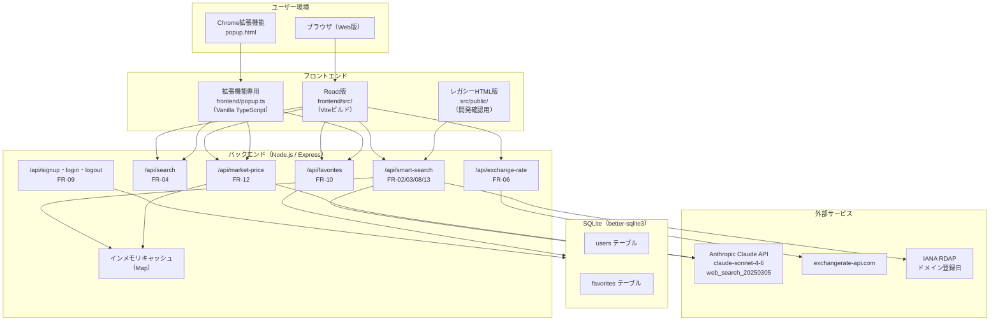
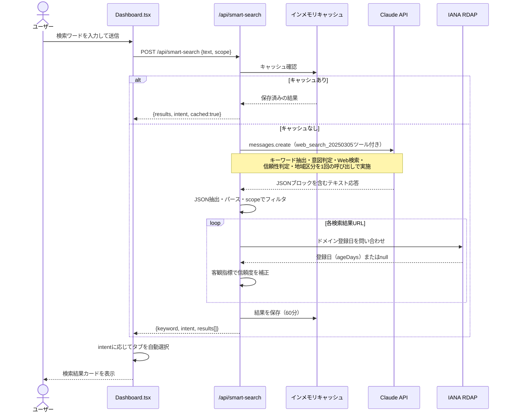
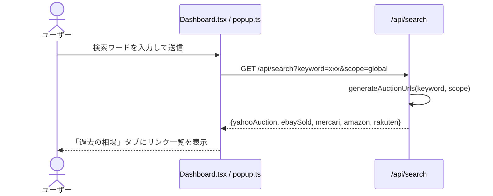
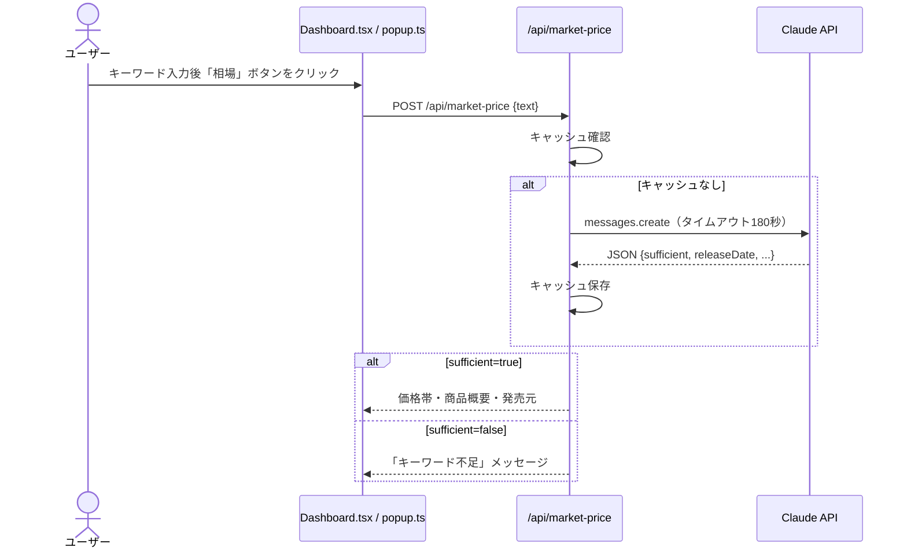
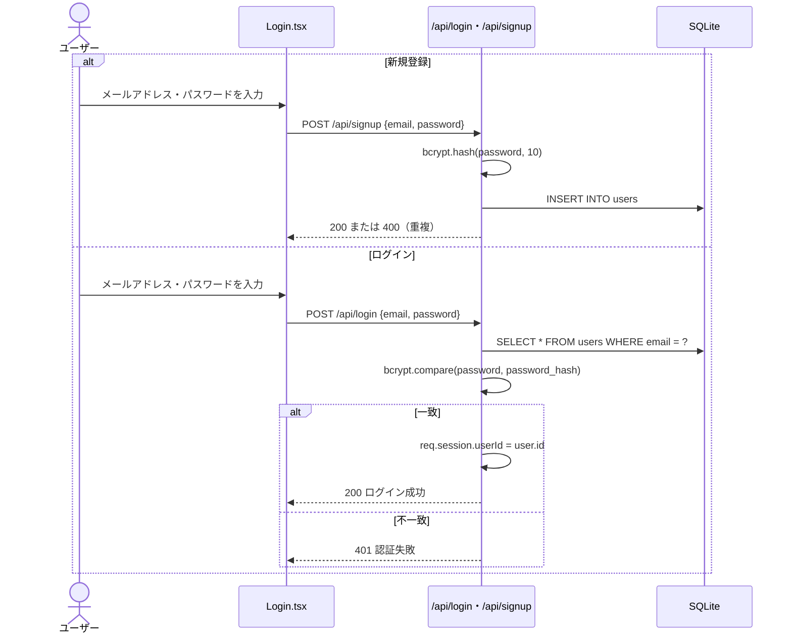
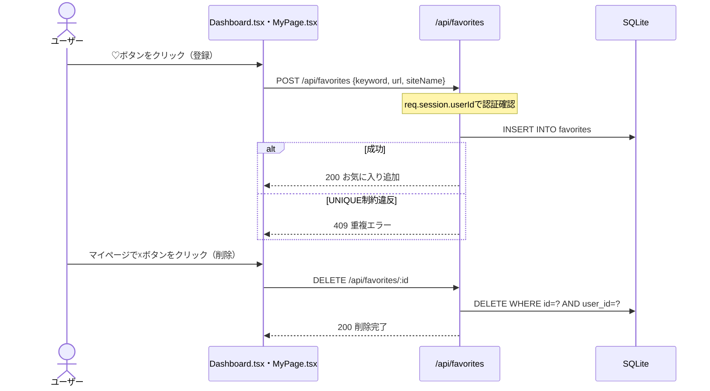
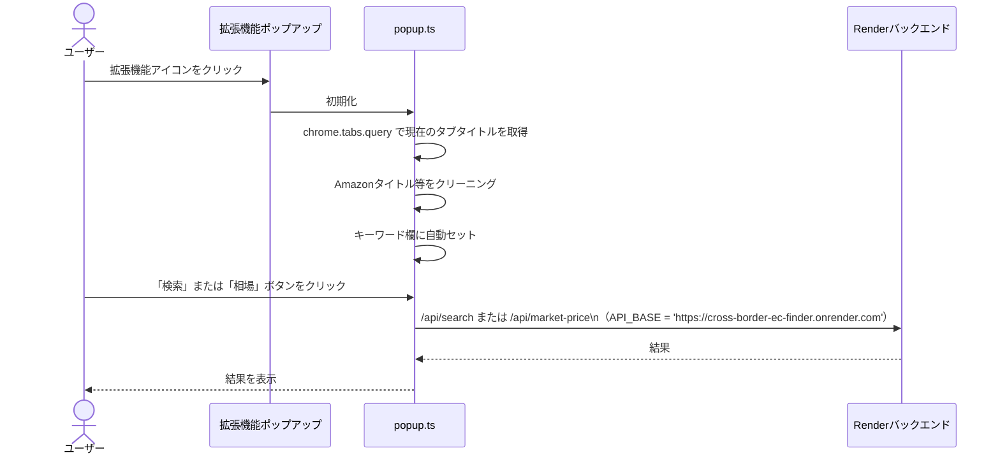
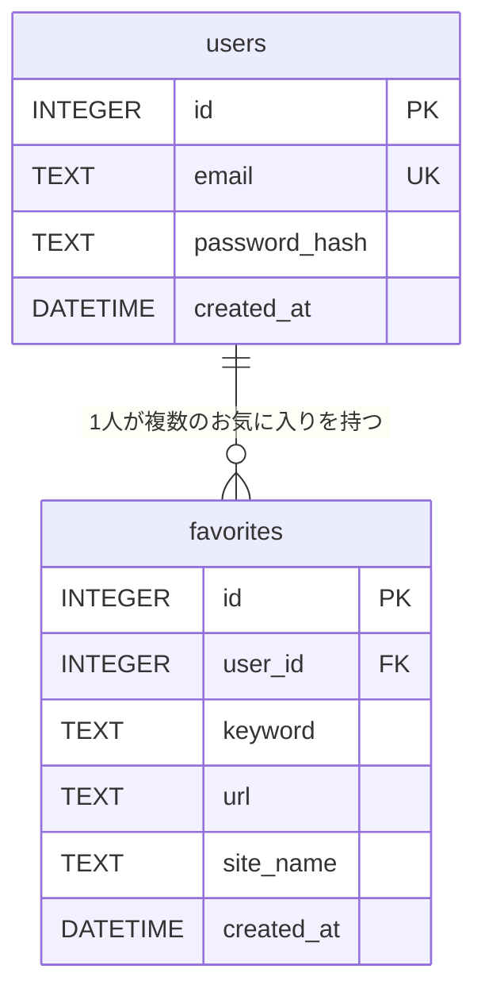
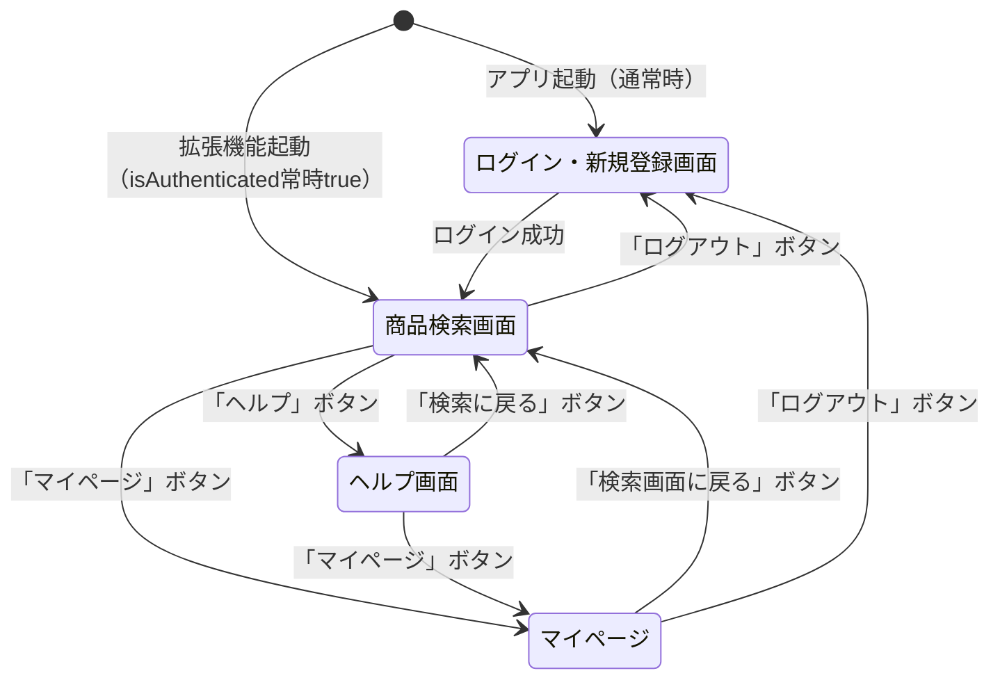

# 基本設計書 — Item Journal（越境EC商品発見支援サービス）

| 項目 | 内容 |
|---|---|
| プロジェクト名 | Item Journal（越境EC商品発見支援サービス） |
| ドキュメント種別 | 基本設計書 |
| 作成日 | 2026年11月 |
| バージョン | v2.1 |
| 対応要件定義書 | docs/要件定義書.md v0.7 |
| 作成者 | ○○ゼミ ○○班 |

---

## 目次

1. [設計方針](#1-設計方針)
2. [全体構成](#2-全体構成)
3. [リポジトリ・モジュール構成](#3-リポジトリモジュール構成)
4. [機能設計](#4-機能設計)
5. [データ設計](#5-データ設計)
6. [API設計](#6-api設計)
7. [認証・セキュリティ設計](#7-認証セキュリティ設計)
8. [異常系・縮退設計](#8-異常系縮退設計)
9. [画面設計](#9-画面設計)
10. [プロンプト設計](#10-プロンプト設計)
11. [インフラ・デプロイ設計](#11-インフラデプロイ設計)
12. [テスト設計](#12-テスト設計)
13. [実装範囲・既知の制限](#13-実装範囲既知の制限)

---

## 1. 設計方針

本サービスの設計・実装にあたり、以下の方針を定める。

### P1 — LLM出力の構造化と検証（ハルシネーション対策）

Claude API の応答は必ず JSON 形式で出力させ、`text.match(/\{[\s\S]*\}/)` でJSONブロックを抽出したうえでパースする。パース失敗時はサーバー側で500エラーを返し、フロントエンドにフォールバックメッセージを表示する。AIが生成したURL・商品説明はあくまで外部サイトへの案内に留め、自社データとして保存・転載しない。

### P2 — プロンプトインジェクション対策

ユーザー入力はプロンプト文字列に直接展開するが、入力値を `「${text}」` とクォートで囲みLLMへの命令本体と分離する。出力側のエスケープはReact版ではJSXの自動エスケープが担う。Vanilla JS版（`src/public/`）では手動の `esc()` 関数が担う。

**限界**：クォートによる分離は基本的な対策であり、高度なプロンプトインジェクションへの完全な防御ではない。非営利・学術用途での運用を前提としたリスク受容。

### P3 — 秘匿情報管理

APIキー（`ANTHROPIC_API_KEY`）は `.env` ファイルで管理し、`src/.gitignore` により Git 管理対象外とする。

**現状の課題**：セッション秘密鍵（後述 7.1）はコードにハードコードされており、本番環境では環境変数への移行が必要。

### P4 — パスワードの安全な保管

ユーザーのパスワードは bcrypt（saltRounds=10）でハッシュ化してDBに保存する。ログイン時は `bcrypt.compare` で検証する。平文での保存・ログ出力は行わない。

### P5 — セッション管理

`express-session` を使用したサーバーサイドセッションを採用する。セッションIDはCookieで送受信し、フロントエンドおよびChrome拡張機能ともに `credentials: 'include'` を明示することでセッションを共有する。

### P6 — 権利遵守方針（NFR-01 最重要制約）

外部サイトのコンテンツ（画像・文章）を自社サーバーに保存・複製しない。外部サイトへはハイパーリンクのみを用い、iframe等での埋め込みは行わない。スクレイピングによるデータ取得は行わない。検索結果の説明はLLMが自身の言葉で要約したものとし、元文章の転載・翻訳表示は行わない。

### P7 — APIコスト抑制

Claude APIのWeb検索は従量課金のため、以下の仕組みでコストを抑制する。

- **結果キャッシュ**：同一検索語・スコープの結果をサーバーのメモリ上（`Map`）に保持（デフォルト60分。`CACHE_MINUTES` 環境変数で変更可）
- **Web検索回数上限**：1回の処理あたりの検索回数を `WEB_SEARCH_MAX_USES`（デフォルト3回）で制限
- **モデル切り替え**：`CLAUDE_MODEL` 環境変数でモデルを指定（デフォルト `claude-sonnet-4-6`）
- **開発用ダミーモード**：`DEV_MOCK=1` でAPIを呼ばずにダミーデータを返す

### P8 — 保守性

環境依存の設定値（モデル名・キャッシュ時間・検索回数等）はすべて環境変数で制御し、コード変更なしに調整できる構成とする。バックエンドのルーティングはエンドポイント単位で分割し、機能IDとの対応を明確にする。

---

## 2. 全体構成

### 2.1 システム構成図



### 2.2 技術スタック

| 層 | 採用技術 | バージョン | 選定理由 |
|---|---|---|---|
| フロントエンド（Web版・拡張機能React部） | React + TypeScript | 19.x | コンポーネント分割・状態管理・型安全 |
| フロントエンド（拡張機能ネイティブ部） | Vanilla TypeScript | — | `chrome.tabs` API等Chrome固有APIの直接利用 |
| ビルドツール | Vite | 8.x | 高速開発サーバー。Web版/拡張機能版の出力先を環境変数で切り替え可能 |
| ルーティング | react-router-dom | 7.x | SPA内ページ遷移。拡張機能ポップアップでは `MemoryRouter` を使用 |
| バックエンド | Node.js + Express | v5.x | 軽量。非同期処理（Claude API呼び出し）と相性が良い |
| データベース | SQLite（better-sqlite3） | 13.x | 卒論・ローカル運用向け。ファイル1つで動作 |
| LLM | Claude API（Anthropic） | claude-sonnet-4-6 | Web検索ツール（`web_search_20250305`）を1回の呼び出しで利用可能。Google Custom Search APIが新規利用不可となったため代替採用 |
| パスワードハッシュ | bcrypt | 6.x | saltRounds=10。P4方針に準拠 |
| セッション | express-session | 1.x | サーバーサイドセッション管理。P5方針に準拠 |
| Chrome拡張機能 | Manifest V3 | — | Googleの現行仕様 |

### 2.3 フロントエンドの2系統について

本サービスのフロントエンドには2種類の実装が並存している。

| 種別 | ファイル | 役割 |
|---|---|---|
| **React版** | `frontend/src/` | Chrome拡張機能のポップアップUIおよびVercel公開用Web版。`popup.html` を入口として Vite でビルドし `extension/` へ出力する |
| **Vanilla TypeScript版（`popup.ts`）** | `frontend/popup.ts` | Chrome拡張機能専用のエントリーポイント。`chrome.tabs` APIによるページタイトル取得と本番APIへの接続を担う |
| **Vanilla JS版（レガシー）** | `src/public/` | バックエンド開発・動作確認用。`app.use(express.static('public'))` で `localhost:3000` から直接配信 |

Vite のビルドエントリーポイントは `frontend/popup.html` であり、そこから `frontend/src/main.jsx` が読み込まれてReactアプリが起動する。`frontend/popup.ts` は Vite のビルド対象ではなく、**要確認**：ビルド設定上 `popup.ts` がどのように拡張機能に組み込まれるかは `vite.config.js` の設定から明確に読み取れない部分があり、実際の動作確認が必要。

### 2.4 環境定義

| 環境 | 説明 | 主な設定 |
|---|---|---|
| ローカル開発（ダミー） | APIを呼ばずに画面確認 | `DEV_MOCK=1` |
| ローカル開発（実API） | バックエンドをローカルで起動して確認 | `CLAUDE_MODEL=claude-haiku-...`（コスト抑制目的） |
| 発表・評価 | 高精度モデルで実動作 | `CLAUDE_MODEL=claude-sonnet-4-6` |
| 本番Web版 | Vercelへデプロイ | `VERCEL=true` を設定してビルド |
| Chrome拡張機能 | ローカルビルドしてChromeに読み込み | `VERCEL` 未設定でビルド |

---

## 3. リポジトリ・モジュール構成

### 3.1 ディレクトリ構成

```
cross-border-ec-finder-main/
│
├── docs/
│   ├── 要件定義書.md
│   └── 基本設計書.md          ← 本ドキュメント
│
├── src/                        # バックエンド（Node.js）
│   ├── index.js                # Expressサーバー本体・全APIエンドポイント
│   ├── db.js                   # SQLiteスキーマ定義・DB接続
│   ├── package.json            # バックエンド依存関係
│   ├── .gitignore              # .env / app.db を除外
│   └── public/                 # レガシーHTML版（開発確認用）
│       ├── login.html
│       ├── search.html
│       ├── mypage.html
│       ├── help.html
│       └── style.css
│
├── frontend/                   # フロントエンド（React + TypeScript + Vite）
│   ├── src/
│   │   ├── main.jsx            # Reactエントリーポイント
│   │   ├── App.tsx             # ルーティング定義（MemoryRouter）
│   │   ├── api.js              # バックエンドAPI呼び出しラッパー
│   │   ├── index.css           # 共通スタイル（デザインシステム）
│   │   └── pages/
│   │       ├── Dashboard.tsx   # 検索・相場・お気に入り登録
│   │       ├── Login.tsx       # ログイン・新規登録
│   │       ├── MyPage.tsx      # お気に入り管理
│   │       └── Help.tsx        # ヘルプコンテンツ
│   ├── popup.ts                # 拡張機能専用エントリー（Vanilla TypeScript）
│   ├── popup.html              # 拡張機能ポップアップ用HTMLエントリー
│   ├── index.html              # Web版用HTMLエントリー
│   ├── vite.config.js          # ビルド設定
│   └── package.json
│
├── extension/                  # Viteビルド出力先（拡張機能パッケージ）
│   ├── manifest.json           # Manifest V3定義（手動管理）
│   ├── popup.html              # ビルド済みHTML
│   ├── popup.js                # ビルド済みJS
│   └── assets/
│       └── popup.css
│
├── package.json                # ルートパッケージ
├── PRIVACY_POLICY.md
└── README.md
```

### 3.2 モジュール依存関係

- `src/index.js`：全エンドポイントを1ファイルに実装。`db.js` からSQLite接続を取得
- `src/db.js`：`better-sqlite3` でDB初期化。`users`・`favorites` テーブルを `CREATE TABLE IF NOT EXISTS` で生成
- `frontend/src/App.tsx`：ルーティングのみ担当。各ページコンポーネントをインポート
- `frontend/src/api.js`：全APIエンドポイント呼び出しを集約。`BASE = 'http://localhost:3000/api'`（現状ハードコード）
- `frontend/popup.ts`：Chrome拡張機能専用。`chrome.tabs` API使用。`API_BASE = 'https://cross-border-ec-finder.onrender.com'`（現状ハードコード）

### 3.3 バックエンド依存パッケージ

| パッケージ | バージョン | 役割 |
|---|---|---|
| `@anthropic-ai/sdk` | ^0.125.0 | Claude API クライアント |
| `bcrypt` | ^6.0.0 | パスワードハッシュ化 |
| `better-sqlite3` | ^13.0.3 | SQLiteドライバ（同期API） |
| `dotenv` | ^17.4.2 | `.env` ファイルの読み込み |
| `express` | ^5.2.1 | HTTPサーバー・ルーティング |
| `express-session` | ^1.19.0 | セッション管理 |
| `cors` | （`package.json` 未記載） | CORS制御。**要確認**：`src/index.js` で `require('cors')` しているが `src/package.json` の `dependencies` に記載がない。`express` の推移的依存として動作している可能性があるが、明示的に追加することを推奨する |

---

## 4. 機能設計

### 4.1 自然言語検索・意図判定・信頼性判定（FR-01 / FR-02 / FR-03 / FR-08）

`/api/smart-search` エンドポイントがFR-01〜03・FR-08・FR-13を統合して処理する。



**客観指標による信頼度補正ルール**

| 指標種別 | 条件 | 分類 |
|---|---|---|
| 強い指標 | ドメイン登録から90日未満 | strong=true |
| 弱い指標 | ドメイン登録から1年未満 | weak++ |
| 弱い指標 | http接続（非暗号化） | weak++ |
| 弱い指標 | 疑わしいTLD（.top/.xyz/.click 等11種） | weak++ |
| 弱い指標 | ドメイン名にハイフンが3個以上 | weak++ |

`strong=true` または `weak>=2` の場合、AI判定に関わらず `trust` を `'risky'` に引き上げる。

### 4.2 URLテンプレート方式による相場サイト案内（FR-04）



対象サイトのURLテンプレート：

| キー | サイト | scopeによる出力 |
|---|---|---|
| yahooAuction | ヤフオク! | global・domestic |
| ebaySold | eBay（落札済み絞り込み） | global・overseas |
| mercari | メルカリ | global・domestic |
| amazon | Amazon | global・domestic |
| rakuten | 楽天市場 | global・domestic |

### 4.3 相場チェック機能（FR-12）



### 4.4 認証フロー（FR-09）



**重要���制限事項**：React版の `App.tsx` では `isAuthenticated` を常に `true` で初期化しており、ログイン状態の判定が実質的に機能していない。これはデモ・拡張機能用途での暫定的な実装であり、実際の認証状態は `/api/me` エンドポイント経由のセッション確認に依存している。Web版では未ログイン時にマイページへ直接アクセスされた場合、サーバー側の401レスポンスで `navigate('/login')` が呼ばれる。

### 4.5 お気に入り登録・管理（FR-10）



### 4.6 Chrome拡張機能（FR-11）

Chrome拡張機能のポップアップには2つの実装が存在する。

**React版（`frontend/src/`）**：ポップアップUIの主要部分。Viteが `frontend/popup.html` を入口としてビルドし、`extension/` ディレクトリへ出力する。`popup.html` → `main.jsx` → `App.tsx` → `Dashboard.tsx` の順で起動する。

**Vanilla TypeScript版（`frontend/popup.ts`）**：Chrome拡張機能専用のエントリーポイント。`chrome.tabs` APIによるページタイトルの自動取得と、Renderの本番APIへの接続を担う。

> **要確認**：`popup.ts` と React版の `main.jsx` のどちらがビルド時に実際にバンドルされるかは、Viteの設定とビルド実行時の確認が必要。両方が同時に動作する構成なのか、`popup.ts` が `popup.html` 内から直接参照される構成なのかを実際のビルド出力で確認すること。



**APIエンドポイントのURL**：

| バージョン | ファイル | API宛先 |
|---|---|---|
| React版（`api.js`） | `frontend/src/api.js` | `http://localhost:3000/api`（ハードコード） |
| Vanilla TS版（`popup.ts`） | `frontend/popup.ts` | `https://cross-border-ec-finder.onrender.com`（ハードコード） |

**要確認事項**：`extension/manifest.json` に `permissions` の記述がない。`popup.ts` が `chrome.tabs.query` を呼び出すためには `"activeTab"` または `"tabs"` パーミッションの宣言が必要。現状の `manifest.json` ではこの宣言が欠落しており、拡張機能の動作に影響する可能性がある。

---

## 5. データ設計

### 5.1 テーブル一覧

#### users テーブル

| カラム名 | 型 | 制約 | 説明 |
|---|---|---|---|
| id | INTEGER | PRIMARY KEY AUTOINCREMENT | ユーザーID |
| email | TEXT | UNIQUE NOT NULL | メールアドレス（ログインキー） |
| password_hash | TEXT | NOT NULL | bcryptハッシュ済みパスワード |
| created_at | DATETIME | DEFAULT CURRENT_TIMESTAMP | 登録日時 |

#### favorites テーブル

| カラム名 | 型 | 制約 | 説明 |
|---|---|---|---|
| id | INTEGER | PRIMARY KEY AUTOINCREMENT | お気に入りID |
| user_id | INTEGER | NOT NULL, FK→users.id | 登録ユーザー |
| keyword | TEXT | NOT NULL | 登録時の検索キーワード |
| url | TEXT | NOT NULL | お気に入りURL |
| site_name | TEXT | — | サイト名（表示用） |
| created_at | DATETIME | DEFAULT CURRENT_TIMESTAMP | 登録日時 |
| — | — | UNIQUE(user_id, url) | 同一ユーザー・同一URL重複禁止 |

### 5.2 ER図



### 5.3 データ保持方針

- 外部ECサイトの商品データ（画像・価格・在庫）は一切保存しない（P6）
- 検索結果のキャッシュはサーバーのメモリ上（`Map`）にのみ存在し、DBには保存しない
- キャッシュキー：`${kind}|${scope}|${text.trim().toLowerCase()}`
- キャッシュ上限：200エントリ（超過時は最古エントリを削除）

---

## 6. API設計

### 6.1 エンドポイント一覧

| メソッド | パス | 機能ID | 認証 | 説明 |
|---|---|---|---|---|
| POST | /api/smart-search | FR-02/03/08/13 | 不要 | 意図判定・Web検索・信頼性判定 |
| GET | /api/search | FR-04 | 不要 | URLテンプレートによる相場サイトURL生成 |
| POST | /api/market-price | FR-12 | 不要 | 相場チェック |
| GET | /api/exchange-rate | FR-06 | 不要 | USD→JPY為替レート取得 |
| POST | /api/signup | FR-09 | 不要 | 新規ユーザー登録 |
| POST | /api/login | FR-09 | 不要 | ログイン |
| POST | /api/logout | FR-09 | 不要 | ログアウト |
| GET | /api/me | FR-09 | セッション | ログイン状態確認 |
| POST | /api/favorites | FR-10 | セッション必須 | お気に入り追加 |
| GET | /api/favorites | FR-10 | セッション必須 | お気に入り一覧取得 |
| DELETE | /api/favorites/:id | FR-10 | セッション必須 | お気に入り削除 |

### 6.2 主要エンドポイントのリクエスト・レスポンス仕様

#### POST /api/smart-search

リクエスト：
```json
{ "text": "ナイキの限定スニーカー", "scope": "global" }
```
`scope` は `"global"` / `"domestic"` / `"overseas"` のいずれか。省略時は `"global"`。

レスポンス（200 OK）：
```json
{
  "keyword": "Nike limited edition sneakers",
  "intent": "current",
  "results": [
    {
      "title": "Nike公式オンラインストア",
      "url": "https://www.nike.com/jp/",
      "snippet": "ナイキ公式サイトで限定スニーカーを探せます。",
      "trust": "trusted",
      "trustReason": "ブランド公式サイトです。",
      "trustEvidence": [],
      "trustAdjusted": false,
      "region": "domestic"
    }
  ],
  "cached": false
}
```

`intent`：`"current"` / `"auction"` / `"unknown"` のいずれか。
`trust`：`"trusted"` / `"unknown"` / `"risky"` のいずれか。
`trustAdjusted`：客観指標でriskyに引き上げられた場合に `true`。

#### POST /api/market-price

リクエスト：`{ "text": "遊戯王 初期版 ブルーアイズ" }`

レスポンス（十分な場合）：
```json
{
  "sufficient": true,
  "releaseDate": "1999年（日本）",
  "manufacturer": "コナミ",
  "description": "遊戯王OCGの初期カード。...",
  "priceRangeLow": 5000,
  "priceRangeHigh": 50000,
  "note": "状態・レアリティにより大きく変動。"
}
```

レスポンス（不十分な場合）：
```json
{ "sufficient": false, "message": "キーワード不足、正式な商品名を入力してください" }
```

### 6.3 共通ルール

- リクエスト本文の Content-Type は `application/json`
- レスポンスはすべてJSON
- エラー時は `{"error": "メッセージ"}` 形式
- バリデーションエラーは `400`、認証エラーは `401`、重複は `409`、サーバー内部エラーは `500`

### 6.4 エラーハンドリング

| ケース | ステータス | レスポンス例 |
|---|---|---|
| 必須パラメータ欠如 | 400 | `{"error": "textが必要です"}` |
| 未ログインでのアクセス | 401 | `{"error": "ログインが必要です"}` |
| 認証失敗 | 401 | `{"error": "メールアドレスまたはパスワードが違います"}` |
| お気に入り重複 | 409 | `{"error": "すでにお気に入り登録済みです"}` |
| Claude API失敗 | 500 | `{"error": "検索に失敗しました"}` |
| 為替レート取得失敗 | 500 | `{"error": "為替レートの取得に失敗しました"}` |

---

## 7. 認証・セキュリティ設計

### 7.1 セッション管理

`express-session` を使用したサーバーサイドセッション。

```javascript
// src/index.js の現在の実装
app.use(session({
  secret: 'kari-no-himitsu-kagi', // ■要変更: 本番では環境変数から取得する
  resave: false,
  saveUninitialized: false
}));
```

| 設定項目 | 現在の実装 | 本番での推奨 |
|---|---|---|
| `secret` | コードにハードコード（`'kari-no-himitsu-kagi'`） | 環境変数 `SESSION_SECRET` から読み込む |
| `cookie.secure` | 未設定（デフォルト: false） | `true`（HTTPS環境で必須） |
| `cookie.httpOnly` | 未設定（`express-session` のデフォルトは `true`） | `true`（現状でも有効） |
| `cookie.sameSite` | 未設定 | `'none'`（クロスオリジン環境での必須設定） |
| セッションストア | デフォルトの `MemoryStore`（本番非推奨） | 本番では `connect-sqlite3` や `connect-redis` への変更を推奨 |

**現状の問題**：セッション秘密鍵がコードに直書きされており、本番環境でのセキュリティリスクがある。コード上に「■要変更」のコメントで対応必要であることは明記済みだが、実装はされていない。`MemoryStore` はプロセス再起動でセッションが失われるため、本番には適さない。

### 7.2 CORS設定

```javascript
app.use(cors({
  origin: (origin, callback) => {
    if (!origin
        || origin.startsWith('chrome-extension://')
        || origin === 'http://localhost:5173') {
      callback(null, true);
    } else {
      callback(new Error('Not allowed by CORS'));
    }
  },
  credentials: true
}));
```

Webサイト版（`localhost:5173`）とChrome拡張機能（`chrome-extension://`）からのリクエストのみを許可し、他のオリジンは拒否する。**本番公開時は許可オリジンにVercelの公開ドメインを追加する必要がある。**

### 7.3 入力検査

現在の実装で行っている検査と、追加が推奨される検査を区別して記載する。

**実装済みの検査：**

| 対象 | 実装済みの検査内容 |
|---|---|
| `/api/smart-search` text | 存在チェック（`if (!text)`） |
| `/api/market-price` text | 存在チェック（`if (!text)`） |
| `/api/search` keyword | 存在チェック（`if (!keyword)`） |
| `/api/signup` email/password | 存在チェック（`if (!email \|\| !password)`） |
| scope パラメータ | 許可値リスト（`normalizeScope`）でサニタイズ |
| フロントエンド出力 | ReactのJSXによる自動エスケープ（React版） |
| フロントエンド出力 | 手動 `esc()` 関数（Vanilla JS版 search.html） |

**追加が推奨される検査（現状未実装）：**

| 対象 | 推奨する検査 | 理由 |
|---|---|---|
| email（signup） | RFC5322形式の正規表現検証 | 形式不正なメールアドレスの登録防止 |
| password（signup） | 最低文字数（例：8文字以上）の確認 | 極端に短いパスワードの防止 |
| text（smart-search/market-price） | 最大文字数制限（例：500文字） | 過剰に長い入力によるAPIコスト増大の防止 |
| url（favorites POST） | `https?://` で始まるURLスキームの検証 | 不正URLスキームのDB保存防止 |
| siteName/keyword（favorites POST） | 最大文字数制限（例：255文字） | 異常に長い文字列の防止 |
| mypage.html の innerHTML | `esc()` / `safeUrl()` の適用 | **現状未対応。蓄積型XSSのリスクあり（後述 7.5）** |

### 7.4 AI入力・返却データの安全性

**ユーザー入力のプロンプトへの組み込み：**

ユーザー入力は `「${text}」` とクォートで囲みLLMへの命令本体と分離している（P2参照）。

**AIの返却JSONの検証：**

| 処理 | 実装済み | 未実装 |
|---|---|---|
| JSONブロックの抽出（`text.match(/\{[\s\S]*\}/)`） | ✅ | — |
| JSON.parseによるパース | ✅ | — |
| パース失敗時のエラーハンドリング | ✅（500を返す） | — |
| `results` 配列の存在確認 | ✅（`Array.isArray(result.results)` を確認） | — |
| 各フィールドのデータ型検証 | ❌ | 文字列フィールドが実際に文字列かの確認なし |
| URLスキームの検証 | ❌（React版） | `javascript:` 等の不正スキームが混入した場合の対策なし |
| URLスキームの検証 | ✅（Vanilla JS版 search.html） | `safeUrl()` 関数で `https?://` で始まるか確認済み |

**React版でのURLスキーム検証の欠如**：`Dashboard.tsx` では `<a href={item.url}>` にそのままURLを渡しており、AIが `javascript:` スキームを含むURLを返した場合の防御が不十分。本番公開前の修正を推奨する。

### 7.5 Vanilla JS版（mypage.html）のXSSリスク

`src/public/mypage.html` のお気に入り一覧描画では、`fav.url`・`fav.site_name`・`fav.keyword` をエスケープせずに `innerHTML` に直接展開している。DBに悪意あるデータが保存されていた場合、ページ表示時に実行される蓄積型XSS（Stored XSS）のリスクがある。

修正方法：`search.html` で定義済みの `esc()` 関数と `safeUrl()` 関数を `mypage.html` にも適用する。

**補足**：React版（`MyPage.tsx`）はJSXの自動エスケープにより安全。

### 7.6 外部リンクの安全性

- すべての外部リンクに `rel="noopener noreferrer"` を付与
- `trust === 'risky'` のURLはクリック時に `confirm()` で警告ダイアログを表示
- iframe等による外部コンテンツの埋め込みは行わない（P6）

---

## 8. 異常系・縮退設計

### 8.1 Claude API障害時

| 障害内容 | フォールバック動作 | フロントエンドの表示 |
|---|---|---|
| ネットワークエラー・タイムアウト（180秒） | `catch` ブロックで 500 を返す | 「検索に失敗しました。」 |
| JSON抽出失敗（出力が不完全な場合） | `throw new Error(...)` → 500を返す | 「検索に失敗しました。」 |
| APIキー未設定 | Anthropicコンストラクタがエラーを投げる | プロセス起動失敗として検知 |
| レートリミット（429） | `catch` ブロックで 500 を返す | 「検索に失敗しました。」（種別を区別しない） |
| 安価なモデルでの出力打ち切り | 高精度モデル（claude-sonnet-4-6）を使用して回避 | — |

**開発用ダミーモード（`DEV_MOCK=1`）**：`/api/smart-search` と `/api/market-price` に対して、APIを呼ばずにダミーデータを返す。ダミーデータには「【ダミー】」が付き本番データと識別できる。APIキーなしでの画面確認に利用する。

### 8.2 検索結果が0件の場合

| 状況 | 表示 |
|---|---|
| 現行販売タブが0件 | 「該当するサイトはありません。」 |
| 過去の相場タブが0件 | 「該当するサイトはありません。」 |
| 相場チェックでキーワード不十分 | 「キーワード不足、正式な商品名を入力してください」 |

### 8.3 SQLite障害時

| 障害内容 | 挙動 |
|---|---|
| DB書き込みエラー（UNIQUE制約以外） | `catch` で 500 を返す |
| UNIQUE制約違反（重複登録） | `err.message.includes('UNIQUE')` を判定し 409 を返す |
| DB接続不能 | プロセス起動時に `better-sqlite3` がエラーを投げ、起動失敗として検知 |

### 8.4 為替レートAPI障害時

`exchangerate-api.com` が利用不能な場合、バックエンドは 500 を返す。フロントエンドは為替レート表示を省略し、他の機能には影響しない。

### 8.5 RDAPドメイン登録日取得失敗時

`fetchDomainAgeDays` 関数は例外をキャッチし `ageDays=null` を返す。`analyzeDomain` は `ageDays=null` の場合、ドメイン年齢の指標を評価対象から除外する。その他の弱い指標（http・疑わしいTLD・ハイフン数）は引き続き評価される。`.jp`・`.co.jp` ドメインはRDAPで登録日を取得できないため、この指標は適用されない（要件定義書 FR-08 の限界として明記済み）。

### 8.6 セッション切れ時

セッションが切れた状態でお気に入り操作等を行うと、バックエンドが 401 を返す。フロントエンドはエラーメッセージを表示するか（React版）、`window.location.href = '/login.html'` にリダイレクトする（Vanilla JS版）。

---

## 9. 画面設計

### 9.1 画面一覧

| 画面ID | 画面名 | コンポーネント（React版） | 対応ファイル（Vanilla JS版） |
|---|---|---|---|
| SCR-01 | ログイン・新規登録画面 | `Login.tsx` | `login.html` |
| SCR-02 | 商品検索画面 | `Dashboard.tsx` | `search.html` |
| SCR-03 | マイページ | `MyPage.tsx` | `mypage.html` |
| SCR-04 | ヘルプ画面 | `Help.tsx` | `help.html` |
| SCR-05 | Chrome拡張ポップアップ | React版 + `popup.ts` | — |

### 9.2 画面遷移図



> Chrome拡張機能は `isAuthenticated` を常に `true` にしているため、起動時に常にSCR-02（検索画面）が表示される。

### 9.3 各画面の仕様概要

#### SCR-01 ログイン・新規登録画面

- 「ログイン」と「新規登録」をページ内のトグルで切り替える（ページ遷移なし）
- バリデーション：`type="email"` + `required` 属性によるHTML標準バリデーション（React版）
- ログイン成功後は検索画面（SCR-02）へ遷移

#### SCR-02 商品検索画面

主要な表示要素：

| 要素 | 内容 |
|---|---|
| 為替レート表示 | 「参考為替レート: 1ドル ≒ xxx円（送料・関税別）」。取得失敗時は非表示 |
| 検索フォーム | テキスト入力 + 「検索」ボタン（黒）+ 「相場」ボタン（赤茶）+ 「リセット」ボタン |
| 相場チェック結果 | フォーム下部に表示。価格帯を大きめの文字で表示 |
| 意図判定ラベル | 「○○の意図と判定し、〜タブを表示しています」 |
| 地域フィルター | 「国内外」「国内」「国外」の3択トグル |
| タブ | 「現行販売」「過去の相場」の2タブ。意図判定結果で自動選択 |
| 検索結果カード | サイト名・信頼性バッジ・判定理由・説明文・♡ボタン |
| 海外サイト注意書き | 海外サイト表示時に自動転送の注意を表示 |

**信頼性バッジの表示**：

| trust値 | 表示 | 背景色 |
|---|---|---|
| `trusted` | 信頼できるサイト | 薄緑 |
| `unknown` | 情報の少ないサイト | 薄黄 |
| `risky` | ⚠️信頼性の低いサイトの可能性があります | 薄赤 |

`risky` のサイトはカードの左端を赤茶色の実線ボーダーで強調し、リンクのクリック時に確認ダイアログを表示する。

#### SCR-03 マイページ

- お気に入りをカード形式で一覧表示（サイト名・登録時キーワード）
- ☓ボタンで個別削除
- 未ログイン状態でのアクセス時はログイン画面へリダイレクト

#### SCR-04 ヘルプ画面

ページ内リンク付き目次から各セクションへジャンプできる。

| セクション | 内容概要 |
|---|---|
| 決済方法 | クレジットカード・PayPal・Wiseの特徴（表形式）。銀行振込のみの注意書き |
| 関税・消費税 | 輸入時に別途課税される仕組みの概要 |
| 怪しいサイトの見分け方 | 警告ボックス＋7項目の確認ポイント |
| 英単語辞典 | Buy It Now・Bid・Sold・Shipping・Ships to・Tracking number |
| 転送サービス | Buyee・Shipito・MyUS の紹介 |

> **注意**：React版（`Help.tsx`）とVanilla JS版（`help.html`）の間で内容に差分がある。英単語辞典の `Ships to`・`Tracking number`、怪しいサイト警告の「なりすましドメイン」「SSLの過信」については `help.html` にのみ記載されており、`Help.tsx` への移植が未完了である。

#### SCR-05 Chrome拡張機能ポップアップ

- 幅350px固定のポップアップウィンドウ
- 起動時に現在閲覧中のページタイトルを取得し、キーワード欄に自動セット（`popup.ts` が担当）
- Amazonの商品タイトル形式（`"Amazon.co.jp : キーワード"`）を自動的に整形する処理あり
- 「検索」ボタンで相場サイトへのURLを一覧表示
- 「相場」ボタンで相場チェックを実行
- お気に入り登録が可能（未ログイン時はログイン案内を表示）

---

## 10. プロンプト設計

LLMへの指示内容はサービス品質に直結するため、エンドポイントごとに方針を記録する。

### 10.1 `/api/smart-search` のプロンプト設計

**目的**：1回の呼び出しでキーワード抽出・意図判定・Web検索・信頼性判定（3段階）・地域区分を完結させる。

**スコープ別の指示切り替え**：

| scope | プロンプト指示の要点 |
|---|---|
| `domestic` | 日本国内向けサイトのみ対象。海外サイトは含めない |
| `overseas` | 海外サイトのみ対象。商品名を英語等に言い換えて検索。日本向けに転送されやすいURLを避け、本来の地域（米国版等）のURLを優先 |
| `global` | 国内外を問わず検索。海外サイトを探すため商品名を英語等に言い換える。海外サイトは本来の地域URLを優先 |

**網羅性を高めるための指示**：
- 大手サイトだけでなく、小規模ショップ・個人運営・新興サイト・情報の少ないサイトも含めて6〜10件程度を採り上げる
- 通常の検索に加えて「格安」「激安」「通販」「輸入」等の語を組み合わせた検索も行う（全件 `trusted` 判定を防ぐための設計的工夫）

**信頼性判定の指示**：

| 判定値 | 判定基準 |
|---|---|
| `trusted` | 商品ブランドの公式サイト・大手ECサイト（Amazon・楽天・eBay・Etsy等） |
| `unknown` | 実在するが小規模・聞き馴染みがない・運営者情報が少ない |
| `risky` | 相場より極端に安い・会社情報の欠如・支払い方法の制限・不自然な表記・なりすましドメイン等の**具体的な根拠が確認できた場合のみ** |

**出力フォーマット（JSON構造の強制）**：

```json
{
  "keyword": "検索に使ったキーワード",
  "intent": "current または auction または unknown",
  "results": [
    {
      "title": "サイト名",
      "url": "URL",
      "snippet": "簡単な説明（自分の言葉で）",
      "trust": "trusted / unknown / risky",
      "trustReason": "判定理由（1文）",
      "region": "domestic または overseas"
    }
  ]
}
```

### 10.2 `/api/market-price` のプロンプト設計

**目的**：入力キーワードの具体性を判定し、十分な場合のみWeb検索で実勢相場を調査して返す。

**出力フォーマット（2パターン）**：

```json
// 十分な場合
{
  "sufficient": true,
  "releaseDate": "発売時期",
  "manufacturer": "発売元・メーカー",
  "description": "商品概要（2〜3文）",
  "priceRangeLow": 数値（円）,
  "priceRangeHigh": 数値（円）,
  "note": "価格帯の根拠・補足"
}
// 不十分な場合
{ "sufficient": false, "message": "キーワード不足、正式な商品名を入力してください" }
```

**設計上の留意点**：
- 海外商品の場合、現地通貨の数値をそのまま円として出力しないようプロンプトで明示指示している
- 価格帯は「一般的な状態」の実勢相場に限定し、鑑定品等の高額事例は `note` 欄に言及させる
- タイムアウト180秒。Web検索回数は `WEB_SEARCH_MAX_USES`（デフォルト3回）で制限

---

## 11. インフラ・デプロイ設計

### 11.1 開発環境での構成

```
[ブラウザ / Chrome拡張] → [フロントエンド開発サーバー localhost:5173]
                                       ↓ Viteプロキシ (/api → localhost:3000)
                        [バックエンド localhost:3000]
                                       ↓
                        [SQLite app.db]
                                       ↓
                        [Claude API / exchangerate-api / RDAP]
```

### 11.2 本番想定構成

`PRIVACY_POLICY.md` にバックエンドのホスト先として「Render」が明記されており、`frontend/popup.ts` の `API_BASE` に `https://cross-border-ec-finder.onrender.com` がハードコードされていることから、以下の構成が想定される。ただし、実際にRenderおよびVercelへのデプロイが完了しているかはソースコードのみでは確認できない。

```
[ブラウザ（Web版）] → [Vercel（フロントエンド静的配信）（要確認）]
                               ↓ HTTPS
[Chrome拡張機能]  → [Render（Node.js / Express バックエンド）（要確認）]
                               ↓
                   [SQLite app.db（永続化要検討）]
```

**要確認**：本番環境での実際のデプロイ設定（Vercel・Renderのダッシュボード設定）はソースコードのみからは確認できない。上記は `popup.ts` の `API_BASE` と `PRIVACY_POLICY.md` の記述を根拠とした推測構成である。

### 11.3 本番移行時の変更が必要な箇所

| 変更箇所 | 現在の状態 | 本番で必要な対応 |
|---|---|---|
| セッション秘密鍵 | コードに `'kari-no-himitsu-kagi'` とハードコード | 環境変数 `SESSION_SECRET` から読み込む |
| CORSの許可オリジン | `localhost:5173` のみ | Vercelの公開ドメインを追加 |
| Cookie設定 | `secure`・`sameSite` 未設定 | `secure: true, sameSite: 'none'` を追加（HTTPS前提） |
| `frontend/src/api.js` の `BASE` | `http://localhost:3000/api` にハードコード | 環境変数（例：`VITE_API_BASE`）で差し替え |
| `extension/manifest.json` の `permissions` | 未記載 | `"activeTab"` を追加（`chrome.tabs.query` の使用に必要） |
| SQLiteの永続化 | ファイルベース（`app.db`） | RenderのFree Tierではファイルがリセットされるため、永続ディスクの利用またはPostgresへの移行を検討 |

### 11.4 環境変数一覧

| 変数名 | 必須 | デフォルト | 説明 |
|---|---|---|---|
| `ANTHROPIC_API_KEY` | ✅ | — | Claude APIキー |
| `CLAUDE_MODEL` | — | `claude-sonnet-4-6` | 使用するClaudeモデル名 |
| `DEV_MOCK` | — | `0` | `1` でダミーモード有効 |
| `CACHE_MINUTES` | — | `60` | キャッシュ保持時間（分）。0で無効化 |
| `WEB_SEARCH_MAX_USES` | — | `3` | 1リクエストあたりの最大Web検索回数 |

> **注意**：`SESSION_SECRET` を環境変数化する実装は現時点では未対応。本番デプロイ前に追加が必要。

### 11.5 ローカル開発の起動手順

```bash
# バックエンド起動
cd src
# .envファイルを新規作成してANTHROPIC_API_KEYを設定する（リポジトリに.env.exampleは存在しない）
npm install
node index.js        # → localhost:3000 で起動

# フロントエンド開発サーバー起動（別ターミナル）
cd frontend
npm install
npm run dev          # → localhost:5173 で起動

# Chrome拡張機能のビルド
cd frontend
npm run build        # → extension/ ディレクトリへ出力
# Chrome: chrome://extensions → デベロッパーモード → 「パッケージ化されていない拡張機能を読み込む」→ extension/ を選択
```

---

## 12. テスト設計

### 12.1 単体テストの方針

現時点では自動化されたテストスイートは未実装（`package.json` の `scripts.test` は `echo "Error: no test specified"` のまま）。以下の関数について手動での動作確認を実施している。

| 対象関数 | 確認内容 |
|---|---|
| `generateAuctionUrls` | scopeごとにURLキーの過不足がないこと。日本語・特殊文字が `encodeURIComponent` で正しくエンコードされること |
| `normalizeScope` | 許可値以外の入力に対して `'global'` を返すこと |
| `getRegistrableDomain` | `.co.jp`・`.com`・`.top` 等の代表的なドメインで正しく抽出されること |
| `applyObjectiveIndicators` | strong=true の場合に trust が risky に変わること。weak=1 では変わらないこと |

### 12.2 結合テストの方針

以下のエンドポイントについて、実際にリクエストを送って動作を確認する。**実施予定**の項目と**実施済み**の項目を区別して記載する。

| エンドポイント | 確認シナリオ | 実施状況 |
|---|---|---|
| POST /api/smart-search | 正常系（global/domestic/overseas）・DEV_MOCK時・キャッシュ利用時 | 開発過程で動作確認済み（記録なし） |
| GET /api/search | keyword有・無（400確認）・各scope | 開発過程で動作確認済み（記録なし） |
| POST /api/market-price | 十分な商品名・曖昧な商品名・DEV_MOCK時 | 開発過程で動作確認済み（記録なし） |
| POST /api/signup | 正常登録・重複メール（400確認） | 開発過程で動作確認済み（記録なし） |
| POST /api/login | 正常ログイン・誤パスワード（401確認） | 開発過程で動作確認済み（記録なし） |
| POST /api/favorites | ログイン済み・未ログイン（401）・重複（409） | 開発過程で動作確認済み（記録なし） |
| エラー時のJSONレスポンス形式 | 全エンドポイントで `{"error": "..."}` 形式であること | コードレビューで確認 |

> **注意**：上記の「開発過程で動作確認済み」はテスト記録として残っているものではなく、開発中の手動確認を指す。正式なテスト記録は作成していない。

### 12.3 ユーザビリティテスト方針

要件定義書 9章に定義されたユーザビリティテストの設計を記載する。**以下はテスト計画であり、実施済みの結果ではない。**

**目的**：本サービスを使うと、単純なキーワード検索（Google等）のみと比較して、同じ時間内により多くの「購入可能な越境ECサイト」を発見できることを検証する。

**タスクシナリオ（例）**：

- シナリオA（現行購入）：「海外限定のナイキのスニーカー（Air Jordan 1 Retro High OG）を購入したい。どこで買えるか調べてほしい。」
- シナリオB（相場確認）：「昔の遊戯王カード（初期版 ブルーアイズ・ホワイト・ドラゴン）の現在の相場が知りたい。」

**測定指標**：

| 指標 | 測定方法 |
|---|---|
| 商品発見数 | タスク完了後に「購入可能だと思ったサイト数」を記録し、単純検索と比較 |
| タスク完了時間 | タスク開始〜完了申告までの秒数 |
| 満足度 | 5件法アンケート（1：まったく役に立たない〜5：非常に役に立った） |
| 待ち時間の許容度 | AI検索の応答時間（実測で数秒〜十数秒）が体験に与える影響 |

### 12.4 性能に関する目標値と実測値

| 項目 | 目標値 | 実測値 | 備考 |
|---|---|---|---|
| `/api/smart-search` 応答時間 | 数秒以内（目標） | 数秒〜十数秒程度（実測） | LLM推論とWeb検索を含むため目標未達。ローディング表示で対応 |
| `/api/market-price` 応答時間 | — | 数十秒〜数分を要する場合あり | タイムアウト180秒・キャッシュで対応 |
| `/api/search` 応答時間 | 即時 | 数ミリ秒（URLテンプレートのみ） | 目標達成 |
| キャッシュヒット時 | 即時 | 数ミリ秒 | 目標達成 |

---

## 13. 実装範囲・既知の制限

### 13.1 機能要件の実装状況

| 機能ID | 機能名 | 実装状況 | 備考 |
|---|---|---|---|
| FR-01 | 自然言語検索 | ✅ 実装済み | テキスト入力から検索を実行 |
| FR-02 | 意図判定・キーワード抽出 | ✅ 実装済み | `/api/smart-search` にFR-03・FR-08と統合 |
| FR-03 | 現行販売サイト案内 | ✅ 実装済み | Claude APIのWeb検索ツール使用（当初のGoogle Custom Search APIは新規利用不可のため変更） |
| FR-04 | 相場サイトURL案内 | ✅ 実装済み | URLテンプレート方式 |
| FR-05 | 検索結果タブ切り替え | ✅ 実装済み | 意図判定結果で初期表示タブを自動選択 |
| FR-06 | 為替換算表示 | ✅ 実装済み | exchangerate-api.com 使用 |
| FR-07 | ヘルプコンテンツ | ✅ 実装済み（差分あり） | React版と Vanilla JS版で内容に差分あり（9.3参照） |
| FR-08 | サイト信頼性判定 | ✅ 実装済み | AI判定 + RDAPによる客観指標補正（当初のGoogle Safe Browsing APIはエラーのため変更） |
| FR-09 | アカウント登録・ログイン | ✅ 実装済み | bcrypt + express-session |
| FR-10 | お気に入り登録 | ✅ 実装済み | ♡登録、マイページで☓削除 |
| FR-11 | Chrome拡張機能 | ✅ 実装済み | Manifest V3。ページタイトル自動取得あり（`popup.ts`） |
| FR-12 | 相場チェック | ✅ 実装済み | Claude API + Web検索ツール。タイムアウト180秒 |
| FR-13 | 検索範囲切り替え | ✅ 実装済み | 国内/国内外/国外の3択 |

### 13.2 設計変更の記録

| 変更内容 | 変更前 | 変更後 | 変更理由 |
|---|---|---|---|
| FR-03 現行販売サイト検索 | Google Custom Search JSON API | Claude APIの `web_search_20250305` ツール | Google Custom Search APIが2027年1月1日までに新規顧客への提供を終了する方針が判明。複数のGoogle Cloudプロジェクトで利用不可を確認 |
| FR-08 信頼性判定 | Google Safe Browsing API | Claude APIによる推論判定 + RDAP客観指標補正 | `API_KEY_SERVICE_BLOCKED` エラーが解消できなかったため |
| FR-05 検索結果表示 | 上下並列表示 | タブ形式（意図判定結果で自動選択） | 意図判定結果をユーザーに分かりやすく提示するために再検討 |
| FR-08 信頼性判定（追加） | AI判定のみ | AI判定 + RDAPドメイン登録日等による客観指標補正 | AI判定単独では根拠が示しにくく、機械的に検証可能な指標を追加 |

### 13.3 既知の制限・課題

| 項目 | 内容 | 対応状況 |
|---|---|---|
| 応答速度（NFR-02） | `/api/smart-search` は実測で数秒〜十数秒かかる | ローディング表示で対処。ストリーミング方式は未実装 |
| 相場チェックの再現性 | 同じ商品名でも価格帯がブレる場合がある | キャッシュ（60分）で同一期間内は同一結果。期間後は再ブレの可能性あり |
| .jpドメインのRDAP | `.jp`・`.co.jp` ドメインで登録日を取得できない | 設計上の限界として許容。他の弱い指標で部分補完 |
| セッション秘密鍵 | `'kari-no-himitsu-kagi'` がコードに直書き | 本番環境では環境変数化が必要（コードに「■要変更」コメントあり） |
| `manifest.json` の `permissions` | `"activeTab"` パーミッションが未宣言 | `popup.ts` が `chrome.tabs.query` を使用しているため追加が必要。未追加の場合、タイトルの自動取得が動作しない可能性がある |
| `cors` の `package.json` 未記載 | `require('cors')` しているが `src/package.json` に未記載 | `npm install cors` で明示的な依存関係として追加することを推奨。現状は `express` の推移的依存として動作している可能性があるが、保証されない |
| React版の `isAuthenticated` | 常に `true` のため、ルート保護が実質無効 | デモ・拡張機能用途での暫定実装。サーバー側の401レスポンスで認証確認を補完 |
| `mypage.html` のXSSリスク | DBから取得したURLを `esc()` なしで innerHTML に展開（Stored XSSリスク） | Vanilla JS版のみ。`esc()` と `safeUrl()` の適用が必要 |
| React版のURL検証欠如 | `<a href={item.url}>` にURLスキーム検証なし | 本番公開前に `safeUrl()` 相当の実装を推奨 |
| `popup.ts` の `API_BASE` | `https://cross-border-ec-finder.onrender.com` にハードコード | 開発時にはこのURLを `localhost:3000` に書き換えるか、環境変数化が必要 |
| `api.js` の `BASE` | `http://localhost:3000/api` にハードコード | Web版本番デプロイ時に環境変数化が必要 |
| 海外サイトの日本版転送 | リンク先が日本版サイトへ自動転送する場合がある | 注意書き表示・海外サイトバッジで対処。転送自体の防止は不可 |
| 自動テスト | テストスイート未整備 | 手動確認のみ。卒論の範囲内として許容 |

### 13.4 将来的な拡張候補

| 項目 | 説明 |
|---|---|
| ストリーミングレスポンス | `/api/smart-search` の結果を受信次第逐次表示することで待ち時間の体感を改善 |
| アフィリエイトリンク対応 | Amazonアソシエイト等のパラメータをURLに付与（NFR-01に準拠した方式） |
| セッションストアの永続化 | `express-session` のストアをSQLiteやRedisに変更し、プロセス再起動でセッションが失われないようにする |
| `SESSION_SECRET` の環境変数化 | 本番デプロイの必須要件として対応 |
| `cors` の明示的な依存管理 | `npm install cors` で `src/package.json` に追加 |
| `manifest.json` への `permissions` 追加 | `"activeTab"` を追加して `chrome.tabs.query` の動作を保証 |
| APIベースURLの環境変数化 | `frontend/src/api.js` の `BASE` と `frontend/popup.ts` の `API_BASE` を環境変数から読み込む形に変更し、開発・本番の切り替えを容易にする |

---

*本設計書は `docs/要件定義書.md`（v0.7）、`src/index.js`・`src/db.js`・`frontend/src/`・`frontend/popup.ts`・`extension/manifest.json`・`src/public/` の実装コードを照合して作成した。*
